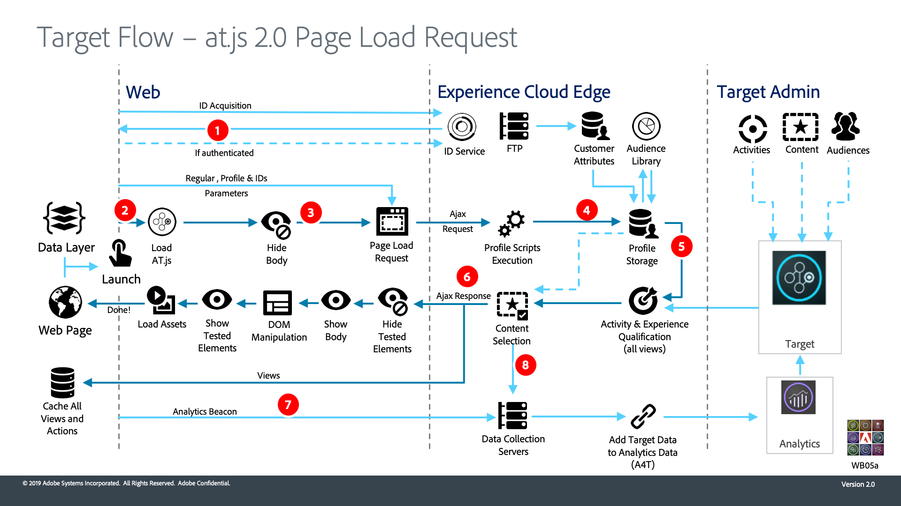
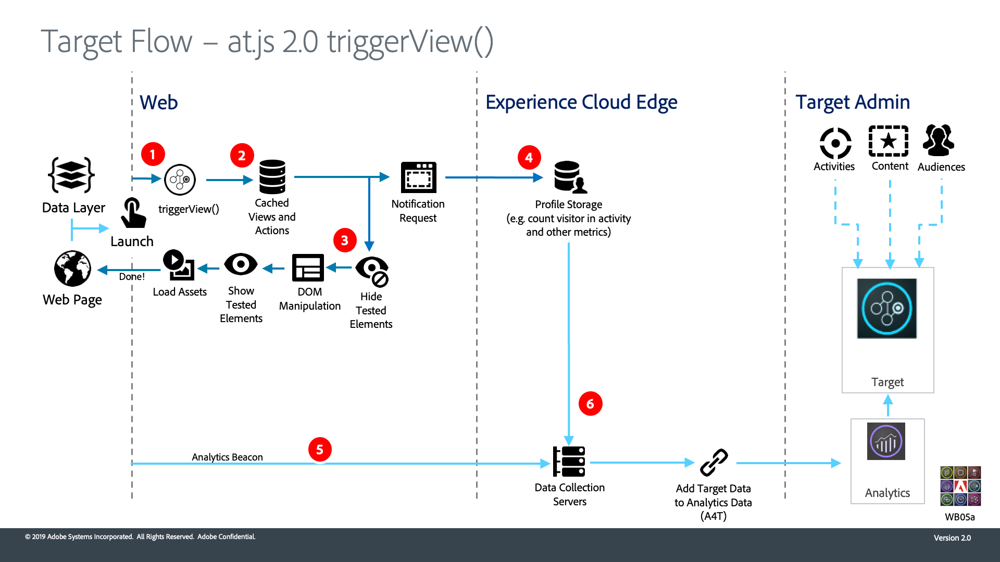

# Understand how Adobe Target's at.js 2.0 works

`at.js` 2.0 enhances Adobe Target's support for single page applications (SPA) and integrates with other Experience Cloud solutions. This video and accompanying diagrams explain how everything comes together.

>[!VIDEO](https://video.tv.adobe.com/v/26250?quality=12)

## Architecture Diagrams

1. Call returns Experience Cloud ID (ECID). If user is authenticated, another call syncs the customer ID.

1. `at.js` library loads synchronously and hides the document body (`at.js` can also be loaded asynchronously with an optional pre-hiding snippet implemented on the page).  

1. Page Load request is made including all configured parameters, ECID, SDID and customer ID.

1. Profile scripts execute and feed into the [!UICONTROL Profile Store]. The Store requests qualified audiences from the [!UICONTROL Audience Library] (e.g. audiences shared from [!DNL Analytics], Audience Manager, etc). [!UICONTROL Customer Attributes] are sent to [!UICONTROL Profile Store] in a batch process.
1. Based on URL, request parameters, and profile data, [!DNL Target] decides which Activities and Experiences to return to the visitor for the current page and future views

1. Targeted content sent back to page, optionally including profile values for additional personalization.

   Targeted content on the current page is revealed as quickly as possible without flicker of default content.

   Targeted content for future views of a single-page application is cached in the browser, so it can be instantly applied without an additional server call when the views are triggered. (See the next diagram for `triggerView()` behavior).

1. [!DNL Analytics] data sent from the page to the [!UICONTROL Data Collection] Servers
1. [!DNL Target] data is matched to Analytics data via the SDID and is processed into the [!DNL Analytics] reporting storage. [!DNL Analytics] data can then be viewed in both [!DNL Analytics] and [!DNL Target] via A4T reports.

1. `adobe.target.triggerView()` is called in the single-page application
1. Targeted content for the view is read from the cache

1. Targeted content is revealed as quickly as possible without flicker of default content

1. Notification request is sent to the [!DNL Target] [!UICONTROL Profile Store] to count the visitor in the activity and increment metrics
1. [!DNL Analytics] data is sent from the SPA to the [!UICONTROL Data Collection] Servers

1. [!DNL Target] data is sent from the [!DNL Target] backend to the [!UICONTROL Data Collection] Servers. [!DNL Target] data is matched to [!DNL Analytics] data via the SDID and is processed into the [!DNL Analytics] reporting storage. [!DNL Analytics] data can then be viewed in both [!DNL Analytics] and [!DNL Target] via A4T reports.

## Additional resources

* [Implement at.js 2.0 in a Single Page Application](implement-atjs-20-in-a-single-page-application.md)
* [Use Adobe Target's Visual Experience Composer for Single Page Applications (SPA VEC)](../experiences/use-the-visual-experience-composer-for-single-page-applications.md)
